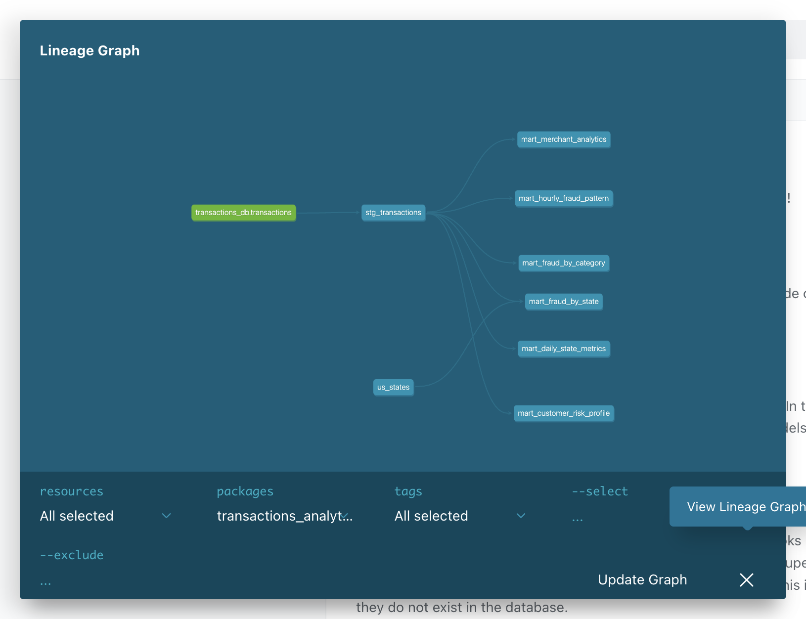

# Аналитика транзакций на dbt и ClickHouse

Слоистый проект dbt поверх размеченных транзакций: сырой источник, staging и шесть витрин.

## Как запустить

Нужны Docker, Python 3.12 и файл `data/train.csv`.

```bash
python3.12 -m venv .venv
source .venv/bin/activate
pip install -r requirements.txt
make pipeline
make docs
make lint
```

`make pipeline` поднимает ClickHouse, загружает CSV, ставит пакеты dbt и выполняет `dbt seed`, `dbt run`, `dbt test`.

Документация уже сгенерирована. Страница с графом:

```bash
cd dbt && ../.venv/bin/dbt docs serve --profiles-dir . --port 8088
```

Открыть http://localhost:8088 и нажать круглую кнопку графа справа внизу. Снимок текущего графа лежит в `dbt/docs/lineage.png`.

Локальный ClickHouse: `localhost:8123`, пользователь `default`, пароль `dbt`. Модели собираются в базу `analytics`, источник остаётся в `transactions_db.transactions`.

## Версии

| Компонент | Версия |
|---|---|
| dbt-core | 1.12.6 |
| dbt-clickhouse | 1.10.3 |
| ClickHouse | 25.3 |
| sqlfluff | 4.5.0 |

## Данные

В витрины попадает только `data/train.csv`, потому что `target` есть только там. В `data/test.csv` признака фрода нет. CSV в git не входит, он слишком большой для GitHub. Файл должен лежать локально, скрипт `scripts/load_transactions.sh` копирует его в контейнер.

Колонки источника — те, что указаны в задании. Лишние поля CSV (`street`, `jobs` и остальные) в таблицу не пишутся.

Отдельного id клиента в источнике нет. Клиент — это имя, фамилия, широта и долгота: одинаковые имя и фамилия встречаются у разных людей, а координаты их разделяют.

## Слои

`transactions_db.transactions` → `stg_transactions` → витрины.

`stg_transactions` обрезает строки, приводит типы, считает час и день недели через `dbt_date`, сегмент суммы через макрос `amount_bucket` и суррогатный ключ клиента через `dbt_utils.generate_surrogate_key`.

| Витрина | Зерно | Что считает |
|---|---|---|
| `mart_daily_state_metrics` | дата, штат | число транзакций, сумма, средний чек, P95, доля крупных |
| `mart_fraud_by_category` | категория | число транзакций, число фродов, fraud_rate, суммы |
| `mart_fraud_by_state` | штат | fraud_rate, уникальные клиенты и мерчанты, суммы, название штата |
| `mart_customer_risk_profile` | клиент | история, fraud_rate, средний чек, сегмент HIGH / MEDIUM / LOW |
| `mart_hourly_fraud_pattern` | день недели, час | fraud_rate и флаг повышенного риска |
| `mart_merchant_analytics` | мерчант | оборот, fraud_rate, флаг подозрительности |

Справочник штатов — seed `us_states`.

## Пороги

Они заданы в `dbt/dbt_project.yml`.

- Сегменты суммы: до 10, до 50, до 200 и от 200. Крупная транзакция — сумма от 200, это примерно 95-й перцентиль.
- Риск клиента: HIGH от 2% фрода, MEDIUM от 0.5% и ниже 2%, иначе LOW. Общая доля фрода чуть больше 0.5%.
- Подозрительный мерчант: fraud_rate от 1.5% и не меньше 100 транзакций, чтобы не помечать мерчантов с парой случайных фродов.
- Повышенный риск часа: fraud_rate слота не ниже 1.5 долей общей fraud_rate.

## Тесты

`dbt test`: **151 тест, все прошли**, предупреждений нет. Лог: `dbt/docs/dbt_test.log`.

- В `schema.yml` стоят `not_null`, `unique`, `accepted_values`, связка штата со справочником и уникальность составных ключей через `dbt_utils`.
- Диапазоны сумм, координат и fraud_rate проверяет `dbt_expectations`.
- Семь singular-тестов в `dbt/tests/`: нет отрицательных сумм, fraud_rate в границах 0–100, суммы витрин сходятся со staging, сегмент риска и флаг мерчанта соответствуют порогам, у каждого штата есть название, час и день недели в допустимых границах.
- Шесть unit-тестов: границы сегментов суммы и календарь, оба порога риска клиента, флаг подозрительного мерчанта, повышенный риск часа, доля крупных транзакций.

`sqlfluff lint` для моделей, тестов и seed проходит. Конфиг — `.sqlfluff`, хуки — `.pre-commit-config.yaml`, оба в корне репозитория. Хуки используют dbt templater, поэтому перед `pre-commit run` нужен `make deps`.

## Описание PR

**Версии:** dbt-core 1.12.6, dbt-clickhouse 1.10.3, ClickHouse 25.3, sqlfluff 4.5.0.

**dbt test** (полный лог — `dbt/docs/dbt_test.log`):

```text
Finished running 145 data tests, 6 unit tests in 0 hours 0 minutes and 2.14 seconds (2.14s).
Completed successfully
Done. PASS=151 WARN=0 ERROR=0 SKIP=0 NO-OP=0 REUSED=0 TOTAL=151
```

**DAG из dbt Docs:**



**Витрины:**

- `mart_daily_state_metrics`
- `mart_fraud_by_category`
- `mart_fraud_by_state`
- `mart_customer_risk_profile`
- `mart_hourly_fraud_pattern`
- `mart_merchant_analytics`

**Тесты:** `not_null`, `unique`, `accepted_values`, `relationships`, `dbt_utils.unique_combination_of_columns`, `dbt_utils.expression_is_true`, `dbt_expectations.expect_column_values_to_be_between`, 7 singular-тестов в `dbt/tests/`, 6 unit-тестов в `dbt/models/unit_tests.yml`.

**Пакеты:** dbt_utils 1.4.1, dbt_date 0.21.0, dbt_expectations 0.10.10. Макрос `amount_bucket` используется в staging.

**Для 10 баллов:** unit tests, sqlfluff (`.sqlfluff`), pre-commit (`.pre-commit-config.yaml`), `Makefile`.

```ini
[sqlfluff]
dialect = clickhouse
templater = dbt
max_line_length = 120
exclude_rules = RF04
runaway_limit = 15

[sqlfluff:templater:dbt]
project_dir = dbt
profiles_dir = dbt
target = dev

[sqlfluff:rules:capitalisation.keywords]
capitalisation_policy = lower

[sqlfluff:rules:capitalisation.functions]
extended_capitalisation_policy = lower

[sqlfluff:rules:capitalisation.literals]
capitalisation_policy = lower

[sqlfluff:rules:capitalisation.types]
extended_capitalisation_policy = lower
```

```yaml
repos:
  - repo: https://github.com/sqlfluff/sqlfluff
    rev: 4.5.0
    hooks:
      - id: sqlfluff-lint
        args: ["--dialect", "clickhouse"]
        files: ^dbt/(models|macros|tests|seeds)/
        additional_dependencies:
          - sqlfluff-templater-dbt==4.5.0
          - dbt-core==1.12.6
          - dbt-clickhouse==1.10.3
      - id: sqlfluff-fix
        args: ["--dialect", "clickhouse"]
        files: ^dbt/(models|macros|tests|seeds)/
        additional_dependencies:
          - sqlfluff-templater-dbt==4.5.0
          - dbt-core==1.12.6
          - dbt-clickhouse==1.10.3
```
